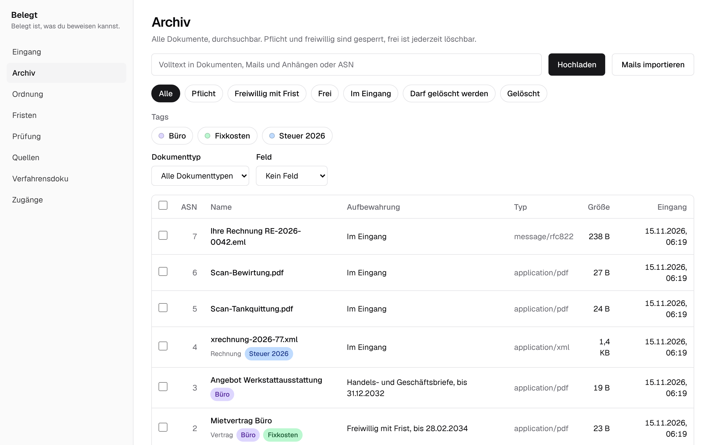
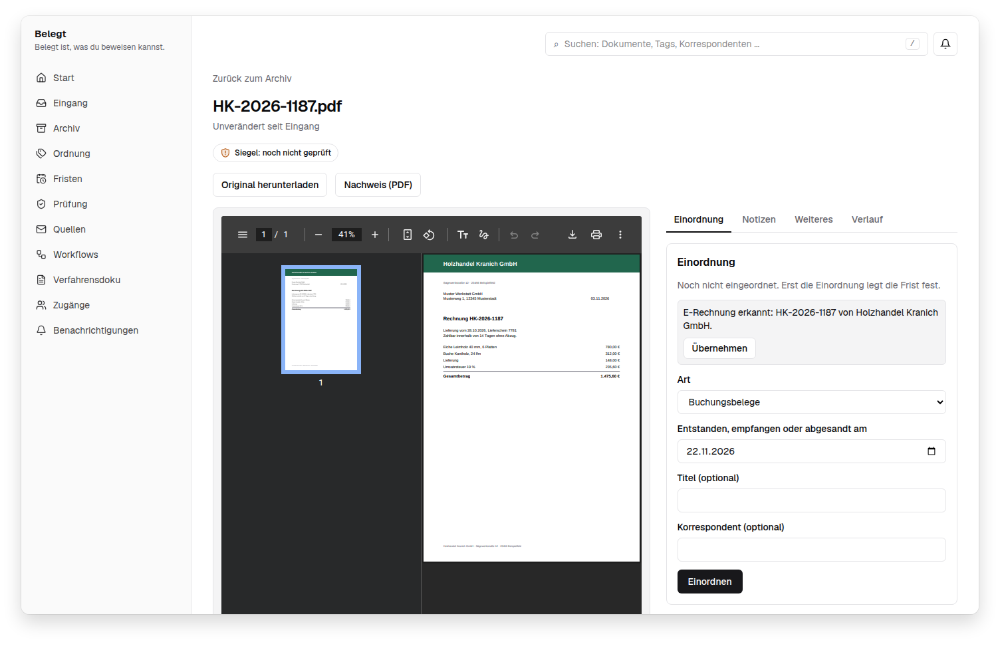
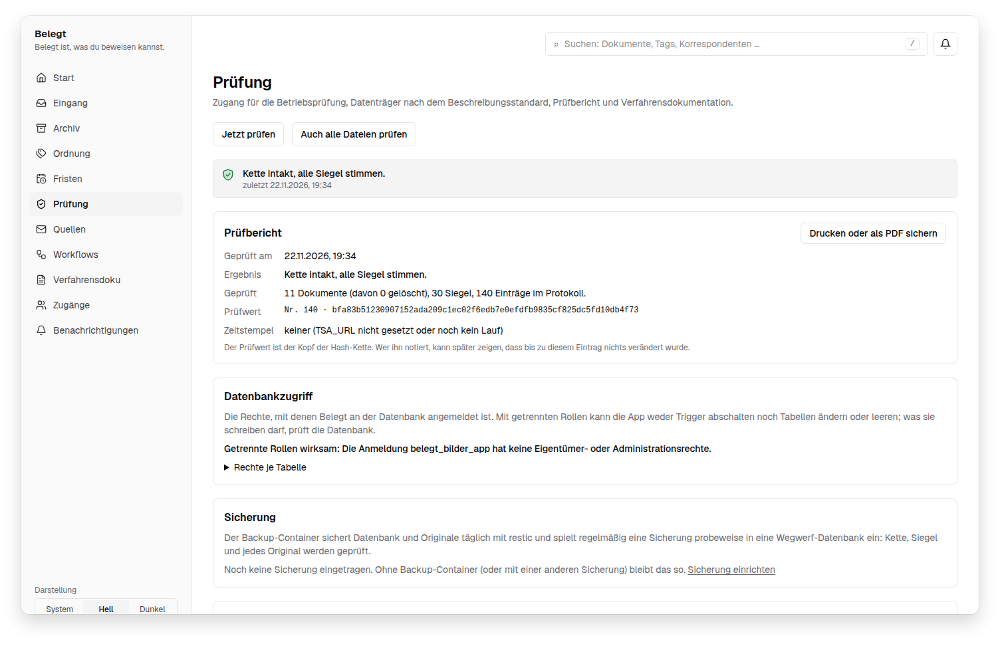
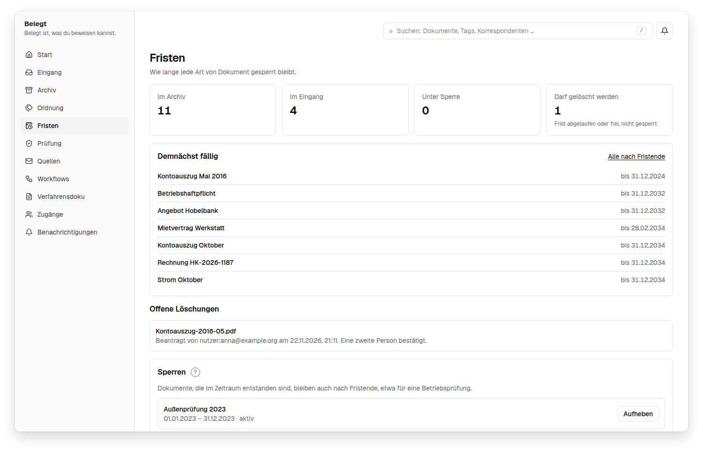
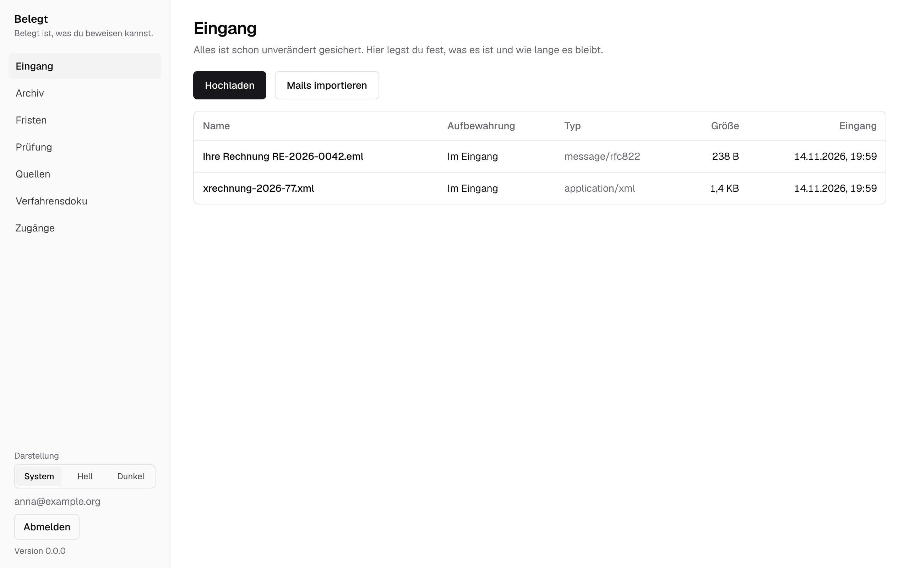

<div align="center">

<h1>Belegt: Dokumentenarchiv mit GoBD-Modus, selbst gehostet</h1>

<picture>
  <source media="(prefers-color-scheme: dark)" srcset="docs/assets/screenshot-archiv-dunkel.png">
  
</picture>

**Belegt ist, was du beweisen kannst.**<br>
Mails, E-Rechnungen, Scans und beliebige Dokumente an einem Ort, durchsuchbar, auf deinem Server. Was aufbewahrt
werden muss, bleibt bis Fristende unverändert, und danach löschst du es nachweisbar.


[](https://github.com/firsttris/belegt/actions/workflows/ci.yml)
[](https://github.com/firsttris/belegt/releases/latest)
[](LICENSE)
[](https://firsttris.github.io/belegt/)
[](https://firsttris.github.io/belegt/pruefung.html)
[](https://firsttris.github.io/belegt/eingang.html#text-und-e-rechnungen)
[](https://firsttris.github.io/belegt/pruefung.html#zeitstempel-rfc-3161)
[](https://firsttris.github.io/belegt/schnittstelle.html#ki-assistenten-mcp)
[](https://www.typescriptlang.org/)
[](https://bun.sh)
[](https://hono.dev)
[](https://www.postgresql.org/)
[](https://hub.docker.com/r/tristanteu/belegt)
[](https://hub.docker.com/r/tristanteu/belegt/tags)

[Warum?](#warum-belegt) •
[Funktionen](#funktionen) •
[Schnellstart](#schnellstart) •
[FAQ](#faq) •
[Dokumentation](https://firsttris.github.io/belegt/) •
[Entwicklung](#entwicklung)

<sub>English: self-hosted document archive with a GoBD mode for German businesses: mails (IMAP, JMAP, Microsoft 365, Google, SMTP journal, PST), e-invoices (ZUGFeRD, XRechnung), scans with OCR and any other file, immutable until the end of the legal retention period, with auditor access and the data medium for tax audits. The app is in German and English; the [documentation](https://firsttris.github.io/belegt/) is in German.</sub>

</div>

> [!WARNING]
> **Beta:** Belegt wird noch stark weiterentwickelt. Vor jedem Update sichern
> ([Sichern](https://firsttris.github.io/belegt/betrieb.html#sichern)); Migrationen lassen sich nicht zurückspielen.

## Warum Belegt?

Wer ein Unternehmen führt, muss Rechnungen, Kontoauszüge und Geschäftsbriefe sechs, acht oder zehn Jahre aufbewahren,
unverändert und auffindbar, und der Betriebsprüfung zeigen können. Ein Ordner auf dem Server oder ein
Dokumentenmanagement reicht dafür selten: Dateien lassen sich ändern, und niemand weiß, wann was gelöscht werden darf.

- **Unveränderbar, wo es zählt**: Siegel und Hash-Kette liegen in PostgreSQL, nicht nur in der App; auf Wunsch S3 mit
  Object Lock bis Fristende und ein täglicher Zeitstempel nach RFC 3161
- **Fristen statt Bauchgefühl**: Belegt rechnet die Frist nach § 147 AO, sperrt bis dahin und lässt danach nur mit
  einer zweiten Person löschen; der Nachweis bleibt
- **Alles an einem Ort**: Mails aus Postfach, Journal oder Outlook-Datei, E-Rechnungen, Scans mit Texterkennung und
  beliebige Dateien, durchsuchbar
- **Bereit für die Prüfung**: Prüferzugang mit Zeitraum, Datenträger nach dem Beschreibungsstandard, Prüfbericht und
  eine Verfahrensdokumentation, die sich selbst aktuell hält
- **Offen für andere Programme**: REST-API, Webhooks, MCP für KI-Assistenten, Anmeldung über OpenID Connect und
  Einbetten in ein Portal; Belegt kennt keine bestimmte andere App
- **Deine Daten bleiben bei dir**: eigener Server, Geheimnisse verschlüsselt, KI-Vorschläge nur mit einem Modell auf
  deinem Server

## Funktionen

| Bereich | Was Belegt kann |
|---|---|
| 📥 [Eingang](https://firsttris.github.io/belegt/eingang.html) | Hochladen per Drag-and-drop, Foto mit dem Handy und Teilen an die installierte App, überwachter Ordner für Scanner mit Trennblättern für Stapel, Mails per IMAP, JMAP, Microsoft 365 und Google (OAuth), SMTP-Journal, Import aus EML, MBOX und PST, [Umzug aus Paperless-ngx](https://firsttris.github.io/belegt/umzug.html) über die API oder aus einem Export |
| 🔎 [Suche](https://firsttris.github.io/belegt/eingang.html) | Volltext über Dateiname, Einordnung, Mail, Text aus PDFs, Word, Excel, PowerPoint, OpenDocument und Texterkennung (Tesseract) für Scans; Office-Dateien auf Wunsch mit Ansicht als PDF; fortlaufende Archivnummer (ASN) |
| 🏷️ [Ordnung](https://firsttris.github.io/belegt/ordnung.html) | Korrespondenten als Liste (umbenennen, zusammenführen), Tags in Farben, Dokumenttypen und eigene Felder (Text, Zahl, Betrag, Datum, Ja/Nein, Auswahl, Link) mit Zuordnungsregeln wie in Paperless-ngx, Vorschlägen, die aus den eigenen Einordnungen lernen, Filter, Suche und gespeicherten Ansichten, jede Änderung im Audit-Log |
| ⚙️ [Workflows](https://firsttris.github.io/belegt/workflows.html) | Wenn ein Dokument ankommt oder eingeordnet wird: Tags, Dokumenttyp, Feldwerte, Notiz oder Webhook nach Bedingungen, genau einmal je Dokument und protokolliert; Startseite mit Eingang, Fristen, Quellen und Kacheln aus gespeicherten Ansichten |
| 📄 [Dokument](https://firsttris.github.io/belegt/dokument.html) | Vorschaubilder der ersten Seite in Liste und Kacheln; durchsuchbares PDF/A für Scans; Seiten drehen, entfernen, teilen und PDFs zusammenfügen als neues Dokument, das Original bleibt; Notizen, die sich nur ergänzen lassen; ähnliche Dokumente |
| 🧾 [E-Rechnungen](https://firsttris.github.io/belegt/eingang.html#text-und-e-rechnungen) | XRechnung und ZUGFeRD erkannt, Nummer, Datum, Verkäufer und Betrag als Vorschlag |
| 🗂️ [Einordnung](https://firsttris.github.io/belegt/fristen.html) | Pflicht, freiwillig mit Frist oder frei; Vorschläge aus Regeln, E-Rechnung und auf Wunsch einem lokalen Sprachmodell |
| ⏳ [Fristen und Löschen](https://firsttris.github.io/belegt/fristen.html) | Fristen nach § 147 AO, Sperren bei Außenprüfung oder Rechtsstreit, Löschen nach Fristende mit zweiter Person |
| 🔒 [Unveränderbarkeit](https://firsttris.github.io/belegt/pruefung.html) | Siegel und Hash-Kette in PostgreSQL, Prüfung von Kette und Dateien, Zeitstempel nach RFC 3161, S3 mit Object Lock |
| 🕵️ [Betriebsprüfung](https://firsttris.github.io/belegt/pruefung.html#prüferzugang-z1) | Prüferzugang mit Zeitraum (Z1), Datenträger mit `index.xml` (Z3), Prüfbericht zum Drucken |
| 📘 [Verfahrensdokumentation](https://firsttris.github.io/belegt/verfahrensdoku.html) | Aus dem tatsächlichen Stand erzeugt, mit deinen Angaben und den Lücken, die noch fehlen |
| 🔌 [Schnittstellen](https://firsttris.github.io/belegt/schnittstelle.html) | REST-API mit OpenAPI, API-Tokens, signierte Webhooks, MCP für Claude und andere Assistenten |
| 🔐 [Anmeldung](https://firsttris.github.io/belegt/einbetten.html) | Konten nur per Einladung, Rollen Inhaber, Steuerberatung, Prüfer und [Mitarbeiter](https://firsttris.github.io/belegt/zugaenge.html) mit Sichtbereich nach Tags, Typen oder Korrespondenten, OpenID Connect, Einbetten in ein Portal, [Teilen per Link](https://firsttris.github.io/belegt/teilen.html) mit Ablauf und Widerruf |
| 🌍 Sprachen | Oberfläche auf Deutsch und Englisch, hell, dunkel oder nach dem Gerät, per Tastatur bedienbar und gegen WCAG 2.2 AA geprüft |

## Screenshots

<table>
  <tr>
    <td width="50%"><picture><source media="(prefers-color-scheme: dark)" srcset="docs/assets/screenshot-dokument-dunkel.png"></picture><br><sub><b>E-Rechnung</b>: erkannt und zum Übernehmen vorgeschlagen</sub></td>
    <td width="50%"><picture><source media="(prefers-color-scheme: dark)" srcset="docs/assets/screenshot-pruefung-dunkel.png"></picture><br><sub><b>Prüfung</b>: Prüfbericht und Datenträger (Z3)</sub></td>
  </tr>
  <tr>
    <td width="50%"><picture><source media="(prefers-color-scheme: dark)" srcset="docs/assets/screenshot-fristen-dunkel.png"></picture><br><sub><b>Fristen</b>: nach § 147 AO, mit Sperren</sub></td>
    <td width="50%"><picture><source media="(prefers-color-scheme: dark)" srcset="docs/assets/screenshot-eingang-dunkel.png"></picture><br><sub><b>Eingang</b>: was noch eingeordnet werden muss</sub></td>
  </tr>
</table>

## Schnellstart

Belegt läuft als Container (`tristanteu/belegt`, amd64 und arm64) neben PostgreSQL; ein zweiter Container aus demselben
Image ruft Postfächer ab, liest Text und stellt Webhooks zu. Du brauchst einen Server mit Docker oder Podman.

```bash
mkdir belegt && cd belegt
curl -O https://raw.githubusercontent.com/firsttris/belegt/main/deploy/compose.yml
curl -o .env https://raw.githubusercontent.com/firsttris/belegt/main/deploy/compose.env.example
chmod 600 .env
```

Trag in `.env` die drei Geheimnisse ein (`POSTGRES_PASSWORD`, `BETTER_AUTH_SECRET`, `BELEGT_SCHLUESSEL`), dann:

```bash
docker compose up -d
docker compose logs server
```

Mit dem Einrichtungscode aus dem Log legst du unter `BELEGT_URL` das erste Konto an, den Inhaber. SMTP-Journal und
Sprachmodell sind eigene Profile (`--profile journal`, `--profile ki`); S3, Zeitstempel, Microsoft 365, Google und
OpenID Connect stehen in [Installation und Betrieb](https://firsttris.github.io/belegt/betrieb.html).

> [!IMPORTANT]
> Sichere `BELEGT_SCHLUESSEL` zusätzlich an einem zweiten Ort. Ohne ihn lassen sich Postfach-Passwörter,
> Refresh-Tokens und Webhook-Geheimnisse nach einer Wiederherstellung nicht mehr lesen.

## FAQ

<details>
<summary><b>Ist Belegt GoBD-konform?</b></summary>

Belegt setzt die technischen Anforderungen um: Unveränderbarkeit per Datenbank, Hash-Kette, Fristen, Löschen mit
Nachweis, Prüferzugang und Datenträger. Zur Ordnungsmäßigkeit gehören außerdem dein Betrieb (Sicherung, Zugänge,
Abläufe) und deine Verfahrensdokumentation. Ein Testat für die Software gibt es nicht; was eine Prüfung braucht, steht
in [Unterlagen für ein Testat](https://firsttris.github.io/belegt/testat.html).
</details>

<details>
<summary><b>Ist das ein Dokumentenmanagement wie paperless?</b></summary>

Es kann das Gleiche (hochladen, Texterkennung, Suche, einordnen), aber mit einem anderen Ziel: Belegt beweist, dass ein
Dokument seit dem Eingang unverändert ist, und weiß, wie lange es aufbewahrt werden muss. Was nicht aufbewahrt werden
muss, legst du „frei“ ab und löschst es, wann du willst. Aus Paperless-ngx ziehst du mit allen Dokumenten, Tags,
Feldern und Notizen um, siehe [Von Paperless-ngx zu Belegt](https://firsttris.github.io/belegt/umzug.html).
</details>

<details>
<summary><b>Kann ich Mails aus Microsoft 365, Google oder Outlook archivieren?</b></summary>

Ja: Postfächer per OAuth (Microsoft 365, Google), IMAP oder JMAP abrufen, alle Mails per SMTP-Journal vom Mailserver
bekommen, oder eine PST-Datei aus Outlook importieren. Siehe
[Eingang, Mails und Suche](https://firsttris.github.io/belegt/eingang.html).
</details>

<details>
<summary><b>Wo liegen meine Dokumente, und was sieht eine KI?</b></summary>

Auf deinem Server, im Dateisystem oder in deinem S3-Bucket. Vorschläge eines Sprachmodells gibt es nur, wenn du eines
einrichtest, und es gehört auf deinen eigenen Server (etwa Ollama); die Verfahrensdokumentation nennt Modell, Server
und was es bekommt.
</details>

<details>
<summary><b>Kann meine Steuerberatung oder die Betriebsprüfung damit arbeiten?</b></summary>

Ja, über eine Einladung: Die Steuerberatung liest und bestätigt Löschungen als zweite Person; ein Prüfer sieht nur
Dokumente seines Zeitraums und lädt den Datenträger herunter. Mitarbeiter sehen nur Dokumente bestimmter Tags, Typen
oder Korrespondenten und ordnen sie auf Wunsch ein. Siehe [Prüfung, Z1 und Z3](https://firsttris.github.io/belegt/pruefung.html)
und [Zugänge](https://firsttris.github.io/belegt/zugaenge.html).
</details>

<details>
<summary><b>Kann ich Claude oder andere Programme anbinden?</b></summary>

Ja: per MCP suchen und lesen KI-Assistenten im Archiv, mit dem Recht „schreiben“ nehmen sie auch auf und ordnen ein;
löschen kann keiner. Für eigene Programme gibt es REST-API, Webhooks und API-Tokens. Siehe
[Schnittstellen](https://firsttris.github.io/belegt/schnittstelle.html).
</details>

<details>
<summary><b>Was kostet Belegt?</b></summary>

Die Software ist kostenlos (AGPL-3.0). Du brauchst nur einen Server.
</details>

## Entwicklung

Voraussetzungen: Bun 1.4.4, PostgreSQL. Befehle, Tests und Umgebungsvariablen stehen in
[Entwicklung](https://firsttris.github.io/belegt/entwicklung.html), wie du mitmachst, in
[CONTRIBUTING.md](CONTRIBUTING.md). Sicherheitslücken bitte privat melden, siehe [SECURITY.md](SECURITY.md).

```bash
bun install
bun run dev:server   # Server auf Port 3000
bun run dev:app      # Oberfläche mit Vite
bun run test         # Vitest, mit TEST_DATABASE_URL auch gegen PostgreSQL
bun run e2e          # Playwright mit axe gegen einen echten Server
```

Belegt nutzt den GoBD-Kern (`@firsttris/gobd-kern`) aus [Haben](https://github.com/firsttris/haben), der
Open-Source-Buchhaltung desselben Projekts.

## Lizenz

[AGPL-3.0](LICENSE). Keine Steuer- oder Rechtsberatung.
