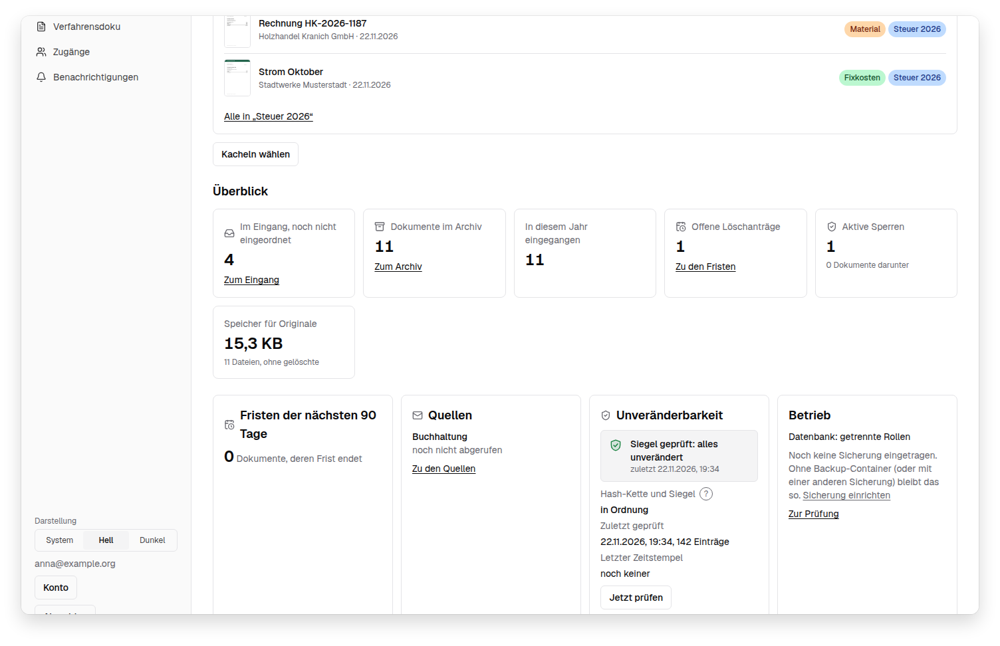

# Eingang

Was ankommt, wird zuerst unverändert gesichert und landet dann im Eingang. Dort legst du fest, was es ist; die Art
bestimmt die Frist ([Fristen](fristen.md)).

## Startseite

Nach dem Anmelden zeigt die Startseite, was ansteht: wie viel im Eingang liegt, wie viele Dokumente das Archiv hat und
wie viele in diesem Jahr eingingen, offene Löschanträge, aktive Sperren mit der Zahl der Dokumente darunter, die Größe
der Originale (jede Datei einmal) und die Fristen, die in den nächsten 90 Tagen enden, mit dem Tag, ab dem das
Dokument löschbar ist. Daneben der Zustand der Quellen (letzter Abruf oder Fehler jedes Postfachs, das letzte Dokument
aus dem Eingangsordner, der letzte Umzug aus Paperless-ngx) und der Unveränderbarkeit: das Ergebnis der Prüfung von
Hash-Kette und Siegeln und der letzte Zeitstempel. Gelöschte Dokumente zählen nirgends mit.

Unter „Kacheln wählen“ zeigst du [gespeicherte Ansichten](ordnung.md#gespeicherte-ansichten) als Kacheln, jede mit der
Zahl der Treffer und den ersten fünf in ihrer Sortierung. Die Auswahl gilt für deinen Zugang. Die Steuerberatung sieht
dieselbe Startseite; der Prüfer nur die Zahlen seines Zeitraums und die Kette, nichts zu Löschanträgen, Sperren,
Quellen und Speicher; ein [Mitarbeiter](zugaenge.md#mitarbeiter) nur die Zahlen seines Sichtbereichs. Der Eingang selbst liegt unter `/eingang`.

## Archivnummer

Jedes Dokument bekommt beim Eingang eine Archivnummer (ASN), fortlaufend in der Reihenfolge des Eingangs: 1, 2, 3 …
Sie steht in der Liste und auf der Seite des Dokuments, damit du sie etwa auf das Papier schreiben kannst. Postgres
vergibt sie in derselben Transaktion wie das Dokument und versiegelt sie; ändern, löschen oder ein zweites Mal vergeben
lässt sie sich nicht. Scheitert eine Aufnahme, bleibt ihre Nummer unbenutzt, es kann also Lücken geben. Dokumente, die
vor der Archivnummer eingegangen sind, haben ihre Nummer nach der Zeit ihres Eingangs bekommen.

## Unterwegs mit dem Handy

**App installieren.** Belegt lässt sich als App auf den Startbildschirm legen: in Chrome oder Edge über „App
installieren“ bzw. „Zum Startbildschirm hinzufügen“, auf dem iPhone in Safari über Teilen → „Zum Home-Bildschirm“. Das
braucht HTTPS (oder `localhost`). Die App ist dieselbe Oberfläche in einem eigenen Fenster; die Dokumente bleiben auf
dem Server. Ohne Verbindung zeigt sie nur einen Hinweis, denn gespeichert wird auf dem Gerät nichts außer dieser
Hinweisseite. Eingebettet in ein Portal ([Einbetten](einbetten.md)) gibt es die App nicht.

**Teilen an Belegt.** Ist die App auf Android (Chrome, Edge, Samsung Internet) installiert, steht Belegt im Menü
„Teilen“ anderer Apps, für PDFs, Bilder, Office-Dateien und Mails (`.eml`). Die Dateien landen zuerst nur auf dem
Handy, auf der Seite **Geteilte Dateien**; erst **In den Eingang** lädt sie hoch, **Verwerfen** löscht sie. Bricht das Hochladen ab, bleiben nur die
Dateien stehen, die noch nicht angekommen sind; ein zweiter Versuch legt nichts doppelt an. Bist du
nicht angemeldet, meldest du dich an und kommst danach zurück zu den Dateien. Beim Abmelden löscht Belegt geteilte
Dateien, die noch nicht hochgeladen sind. Hochladen darf nur der Inhaber. Auf dem iPhone und in Firefox gibt es das
Teilen an eine Web-App nicht; dort lädst du über **Hochladen** hoch.

**Foto aufnehmen.** Im Eingang öffnet **Foto aufnehmen** auf dem Handy die Kamera, auch auf dem iPhone, am Rechner die
Auswahl für Bilder. Jedes Foto geht sofort in den Eingang, danach nimmst du das nächste auf. Für mehrseitige Belege ist
ein Scan als PDF besser ([Trennblätter](#trennblätter)).

## Eingangsordner

Mit `EINGANG_ORDNER` überwacht der Worker einen Ordner, etwa das Ziel eines Scanners oder eine Netzwerkfreigabe
([Betrieb](betrieb.md#eingangsordner)). Alle 5 Sekunden schaut er hinein und nimmt jede Datei auf, die sich seit dem
letzten Blick nicht verändert hat; was der Scanner noch schreibt, wartet bis zum nächsten Blick. Die Quelle des
Dokuments ist dann „Ordner“. Erst wenn die Datei im Archiv liegt, entfernt Belegt sie aus dem Ordner; eine Datei, die
schon im Archiv liegt, entfernt es nur. Schreibt der Scanner nach einer Pause weiter, während Belegt die Datei aufnimmt,
bleibt sie liegen und kommt vollständig ins Archiv, sobald sie sich nicht mehr ändert; der zuerst aufgenommene Teil
bleibt als eigenes Dokument.

Unterordner liest der Worker mit, versteckte Dateien (mit Punkt am Anfang) und temporäre (`.tmp`, `.part`, `~$…`)
lässt er liegen, und Verknüpfungen (Symlinks) folgt er nicht; einen Unterordner, den er nicht lesen darf, überspringt er
und meldet ihn einmal im Log. Dateien über 100 MB verschiebt er nach `fehler/` im Ordner, leere erst, wenn sie
10 Minuten lang leer geblieben sind (mancher Scanner legt die Datei zuerst an); dort bleiben sie liegen, bis du sie
klärst. Ist die Datenbank oder der Speicher gerade nicht
erreichbar, bleibt die Datei im Ordner, und der Worker versucht es wieder.

Mit `EINGANG_ORDNER_TAGS=true` bekommt jedes neue Dokument die Namen seiner Unterordner als [Tags](ordnung.md), jede
Ebene einen: `Steuer/2026/beleg.pdf` bekommt „Steuer“ und „2026“. Fehlt ein Tag, legt Belegt ihn an; einen
vorhandenen erkennt es ohne Unterschied zwischen Groß- und Kleinschreibung. Ohne die Einstellung bleiben Unterordner
ohne Bedeutung.

## Trennblätter

Damit du einen ganzen Stapel Belege in einem Rutsch scannen kannst, legst du zwischen zwei Belege ein Trennblatt. Es
liegt unter Quellen → Scannen zum Ausdrucken bereit (`/api/trennblatt.pdf`) und trägt einen QR-Code und einen Code 128
mit dem Inhalt `BELEGT-TRENNER` (anders mit `TRENNBLATT_CODE`). Ein PDF aus dem Eingangsordner teilt Belegt an jedem
Trennblatt; aus `stapel.pdf` werden `stapel-1.pdf`, `stapel-2.pdf` … Jedes Teil ist ein eigenes Dokument mit eigener
Archivnummer; die Trennblätter und der Stapel selbst kommen nicht ins Archiv, der Stapel ist nur das Transportmittel.
Beim Hochladen über die Schnittstelle teilt `POST /api/dokumente?trennen=1` genauso ([API](api.md)). Dabei teilt der
Server höchstens zwei Stapel zugleich, vier weitere warten; darüber hinaus antwortet er mit 503 und `Retry-After`, statt
den Stapel ungeteilt aufzunehmen.

Ein PDF ohne Trennblatt oder mit mehr als 200 Seiten bleibt, wie es ist. Lässt sich ein Stapel nicht teilen (kaputtes PDF, länger als das Zeitlimit),
nimmt Belegt ihn unverändert auf. Ohne `pdftoppm` (Poppler, im Image enthalten) teilt Belegt nicht.

## Mails

Eine Mail wird als Original (`.eml`) aufbewahrt. Daraus liest Belegt Absender, Empfänger, Betreff, Datum, den Text
und die Anhänge; Anhänge bekommen ihren eigenen SHA-256. Antworten hängen über `In-Reply-To` und `References` an
ihrer Unterhaltung.

Mails importierst du im Eingang oder Archiv mit „Mails importieren“, als `.eml` oder als MBOX (Export aus
Thunderbird oder Google Takeout); Belegt teilt ein Archiv in einzelne Mails. Jede Mail wird ein Dokument
(`message/rfc822`), jeder Anhang ein eigenes Dokument mit Verweis auf seine Mail; beides ist versiegelt. Eine Mail mit
denselben Rohdaten nimmt Belegt nicht zweimal auf, ein wiederholter Import desselben Archivs ist also harmlos. Auf der
Seite einer Mail stehen Kopf, Text, Anhänge und die Unterhaltung.

## Postfächer

Unter Quellen trägst du Postfächer ein (IMAP: Server, Port, TLS, Benutzer, Passwort, Ordner). Der Worker
(`bun server/worker.ts`, eigener Prozess) holt alle `ABRUF_MINUTEN` neue Mails ab, nur lesend; im Postfach ändert
Belegt nur, was du als [Aktion nach dem Abholen](#nach-dem-abholen) einstellst. Er merkt sich je Postfach die letzte UID; nummeriert der Server das Postfach neu
(UIDVALIDITY), beginnt er von vorn, und doppelte Mails erkennt der Import. „Jetzt abrufen“ startet einen Abruf sofort.
Fehler stehen am Postfach. Das Passwort liegt verschlüsselt in der Datenbank (AES-256-GCM, Schlüssel
`BELEGT_SCHLUESSEL`) und erscheint weder in der Oberfläche noch im Audit-Log.

Mit der Art **JMAP** (etwa bei Stalwart) holt Belegt die Sitzung unter `https://<Server>:<Port>/.well-known/jmap` und
meldet sich mit Benutzer und Passwort an. Zeigt die Sitzung für API oder Download auf einen anderen Host oder Port,
bricht der Abruf ab, damit die Zugangsdaten nur an diesen Server gehen. Der Ordner ist sein Name oder seine Rolle (`INBOX` für den Posteingang).
Beim ersten Abruf kommt der ganze Ordner, danach nur, was seit dem letzten Abruf neu hineinkam oder hineinverschoben
wurde (`Email/changes`). Kennt der Server den alten Stand nicht mehr, holt Belegt den Ordner neu.

### Microsoft 365 und Google

Bei Microsoft 365 und Google meldet sich Belegt per OAuth an statt mit einem Passwort. Dafür registrierst du einmal
eine App beim Anbieter, mit `<BELEGT_URL>/api/oauth/rueckkehr` als Weiterleitungsadresse:

- **Microsoft Entra ID:** App-Registrierung (Web), delegierte Berechtigungen `IMAP.AccessAsUser.All` (Office 365
  Exchange Online) und `offline_access`, ein geheimer Clientschlüssel. In `.env`: `MICROSOFT_CLIENT_ID`,
  `MICROSOFT_CLIENT_SECRET`, für ein einzelnes Unternehmen `MICROSOFT_TENANT` (sonst `common`).
- **Google Cloud:** OAuth-Client vom Typ Webanwendung, Gmail-API aktiviert, Bereich `https://mail.google.com/`. In
  `.env`: `GOOGLE_CLIENT_ID`, `GOOGLE_CLIENT_SECRET`. Für Konten außerhalb deiner eigenen Workspace-Organisation
  verlangt Google für diesen Bereich eine Prüfung der App.

Unter Quellen erscheint dann „Mit Microsoft 365 verbinden“ oder „Mit Google verbinden“. Nach der Anmeldung beim
Anbieter legt Belegt das Postfach mit der Adresse des Kontos an. Gespeichert ist nur das Refresh-Token, verschlüsselt
wie ein Passwort; vor jedem Abruf holt Belegt damit ein Access-Token.

### Nach dem Abholen

Je Postfach stellst du unter Quellen mit „Aktion ändern“ ein, was mit einer Mail im Postfach geschieht, sobald sie im
Archiv liegt: keine Aktion (Vorgabe), als gelesen markieren, markieren (Flagge, in Gmail ein Stern), in einen Ordner
verschieben oder löschen. Das geht bei IMAP, JMAP, Microsoft 365 und Google gleich; einstellen darf das nur der
Inhaber. Den Zielordner zum Verschieben wählst du aus den Ordnern des Postfachs; einen, den es nicht gibt, nimmt Belegt
nicht an.

Die Aktion läuft im Worker nach dem Abruf, und nur für eine Mail, die nachweislich im Archiv liegt: Die Aufnahme ist in
der Datenbank festgeschrieben, die Mail ist im Archiv nicht gelöscht, und vor der Aktion liest Belegt das Original aus
dem Speicher und vergleicht seinen SHA-256. Scheitert das, bleibt die Mail im Postfach unberührt. Eine Mail, die schon vorher im Archiv lag (doppelt), gilt
als archiviert und bekommt die Aktion auch. Jede Mail bekommt die Aktion einmal: Ist sie inzwischen weg oder hat der
Server den Ordner neu nummeriert (UIDVALIDITY), entfällt sie, und der nächste Abruf ordnet die Mail neu zu. Einen
Fehler (Zielordner fehlt, Verbindung bricht ab) hält Belegt fest und versucht es höchstens fünfmal, nach 15, 30, 60 und
120 Minuten. Schaltest du die Aktion ab, entfällt, was noch offen war. Jedes Ergebnis steht unter „Protokoll der
Aktionen“ am Postfach, in einem Protokoll, das sich nicht ändern lässt, und im Audit-Log.

**Löschen** musst du beim Einstellen ausdrücklich bestätigen; wer und wann, steht am Postfach und in der
Verfahrensdokumentation. Gelöscht wird frühestens nach einer Wartezeit ab der Archivierung (Vorgabe 24 Stunden, 1 bis
2160), damit eine [Sicherung](betrieb.md#sichern) des Archivs dazwischen liegt, und nur, wenn die Mail im Postfach Byte
für Byte dem Original im Archiv gleicht. Mit [S3 und Object Lock](betrieb.md#dateien-in-s3-mit-object-lock) kannst du
zusätzlich verlangen, dass die Datei im Bucket bis zum Fristende gesperrt ist; das ist sie erst, wenn die Mail
eingeordnet ist. Gmail behandelt Löschen über IMAP nach seinen eigenen Einstellungen (oft nur Archivieren); bei IMAP
ohne UIDPLUS entfernt das Löschen auch andere Mails im Ordner, die schon als gelöscht markiert waren.

## Regeln

Regeln (Seite Quellen) schlagen eine Art vor, etwa „Mails von `telekom.de` mit PDF sind Belege“. Für einen Anhang
gelten die Merkmale seiner Mail. Eine Regel kann auf Absender,
Domain (auch Subdomains), einen Teil des Betreffs und den Typ eines Anhangs prüfen; alle Bedingungen müssen
zutreffen, die erste passende Regel gewinnt. Eine Regel ohne Bedingung trifft nichts.

Eine Regel kann zusätzlich Tags, einen Korrespondenten, einen Dokumenttyp und Feldwerte vorschlagen
([Ordnung](ordnung.md)), oder nur diese:
Mit „Keine Art, nur Ordnung“ taggt sie, ohne eine Art vorzuschlagen. Was seitdem gelöscht wurde, schlägt sie nicht mehr
vor.

Ein Vorschlag setzt noch keine Frist. „Übernehmen“ setzt Tags, Korrespondent, Dokumenttyp und Feldwerte sofort und
trägt die Art, wenn die Regel eine hat, ins Formular; erst wenn du einordnest, wird das Dokument eingeordnet und
gesperrt. Was ohne Klick geschehen soll, erledigt ein [Workflow](workflows.md).

## Vorschläge

Auf der Seite eines Dokuments im Eingang stehen die Vorschläge in dieser Reihenfolge:

1. [Regel](#regeln): Art und Ordnung nach Absender, Domain, Betreff und Anhang.
2. [Zuordnungsregel](ordnung.md#zuordnungsregeln) an Korrespondenten, Dokumenttypen und Tags.
3. [Gelernt](ordnung.md#gelernte-vorschläge) aus den eigenen Einordnungen; ohne, was Regel und Zuordnungsregel schon
   vorschlagen, denn die hast du selbst festgelegt.
4. E-Rechnung und Import aus Paperless-ngx: Datum, Titel und Korrespondent.
5. [Sprachmodell](#vorschläge-eines-sprachmodells), wenn eingerichtet.

Jeder Vorschlag hat sein eigenes „Übernehmen“; keiner ordnet von selbst ein.

## Suche

Die Suche im Archiv geht über den Volltext: Dateiname, Titel und Korrespondent der Einordnung, der Korrespondent aus
der Liste, bei Mails Absender,
Betreff und Text, bei Anhängen dazu Absender und Betreff ihrer Mail, dazu der Text aus PDFs, Office- und Textdateien
Nummer und Verkäufer einer E-Rechnung, Tags, Dokumenttyp und Textfelder ([Ordnung](ordnung.md)) und Notizen ([Dokument](dokument.md#notizen)). Sie versteht deutsche Wortformen („Rechnungen“ findet „Rechnung“), Wortgruppen in Anführungszeichen
und Ausschlüsse mit Minus. `ASN 123` oder nur `123` findet das Dokument mit dieser Archivnummer.

## Outlook-Datendateien (PST, OST)

„Mails importieren“ nimmt auch eine PST oder OST aus Outlook. Die Datei selbst kommt unverändert als eigenes Dokument
ins Archiv; sie ist das Original. Outlook speichert Mails darin nicht als MIME, sondern als Felder; Belegt baut aus jeder
Mail eine .eml mit den Kopfzeilen, wie sie beim Empfang ankamen (sonst aus Absender, Empfängern, Betreff und Datum),
mit Text, HTML und Anhängen, und nimmt sie wie jede andere Mail auf. Termine, Kontakte und Aufgaben übernimmt Belegt
nicht. Dieselbe Datei ein zweites Mal ergibt dieselben .eml, also keine doppelten Mails. Größer als 100 MB darf die
Datei nicht sein; eine größere teilst du in Outlook auf.

## Vorschläge eines Sprachmodells

Mit `KI_URL` und `KI_MODELL` fragt der Worker ein Sprachmodell nach einer Einordnung für jedes Dokument im Eingang: Art,
Tag der Entstehung, Titel, Korrespondent und eine kurze Begründung; gibt es Tags und Dokumenttypen, wählt es passende
davon aus, neue legt es nie an. Für den Korrespondenten bekommt es die Namen der Liste und nimmt deren Schreibweise. Er schickt dafür Dateiname, Mailkopf und Text des
Dokuments an das Modell; deshalb gehört es auf einen eigenen Server, etwa Ollama im selben Netz (in Compose mit
`--profile ki`, dann einmal `docker compose exec ollama ollama pull <Modell>`). Ein Vorschlag ist nur ein Vorschlag: Auf
der Seite des Dokuments übernimmt „Übernehmen“ die Felder ins Formular, eingeordnet wird erst mit „Einordnen“. Belegt
prüft jede Antwort (nur die bekannten Arten, nur Tage, die es gibt); Anweisungen im Text eines Dokuments ändern daran
nichts. Gefragt wird, sobald der Text gelesen ist; bei `.doc`, `.xls`, `.ppt` und `.rtf` wartet der Worker mit
`VORSCHAU_URL` auf den Text aus der [Ansicht](#ansicht-von-office-dateien), ohne fragt er gleich. Der Vorschlag ist aus
dem Inhalt abgeleitet und geht mit der Löschung mit. Die Verfahrensdokumentation nennt Modell und Server.

## SMTP-Journal

Statt Postfächer abzurufen, kann der Mailserver jede Mail zusätzlich per SMTP an Belegt schicken (Journal, etwa per
Kopie an eine eigene Adresse mit Weiterleitung zu Belegt). Belegt archiviert sie unverändert, so wie sie ankommt. Der
Dienst läuft als eigener Prozess (`bun server/smtp.ts`, in Compose mit `--profile journal`) auf `SMTP_PORT` (2525).

Der Mailserver meldet sich mit AUTH an: Benutzername beliebig, Passwort ein API-Token mit dem Recht schreiben. Im
Protokoll steht dann `token:<Name>`, und ein widerrufenes Token wird abgelehnt. `SMTP_EMPFAENGER` beschränkt die
angenommenen Empfänger (mit Komma getrennt). Mit `SMTP_TLS_KEY` und `SMTP_TLS_CERT` bietet Belegt STARTTLS an; ohne
geht die Anmeldung im Klartext, das nur in einem eigenen, geschützten Netz. Eine Mail, die schon im Archiv liegt, nimmt
Belegt an, legt sie aber nicht doppelt ab. Klappt die Aufnahme nicht, antwortet es mit 451, und der Mailserver versucht
es später noch einmal.

## Text und E-Rechnungen

Kurz nach dem Eingang liest der Worker jedes PDF und XML: den Text eines PDFs für die Suche und die Kopfdaten einer
E-Rechnung nach EN 16931, als XRechnung (UBL oder CII) oder eingebettet in ein PDF (ZUGFeRD, Factur-X). Auf der Seite
des Dokuments stehen dann Nummer, Datum, Verkäufer, Käufer und Gesamtbetrag (BT-1, BT-2, BT-27, BT-44, BT-112). Beim
Einordnen übernimmt „Übernehmen“ Datum, „Rechnung <Nummer>“ als Titel und den Verkäufer; die Art kommt aus einer
passenden Regel, sonst „Buchungsbeleg“. Geprüft wird die Rechnung dabei nicht, und maßgeblich bleibt das Original.
Bilder (JPEG, PNG, WebP) und PDFs ohne Textebene gehen durch die Texterkennung (Tesseract, Deutsch und Englisch);
die Seite des Dokuments sagt dann „aus der Texterkennung“, und es gibt ein [durchsuchbares
PDF](dokument.md#durchsuchbares-pdf). HEIC liest sie nicht. Von einem PDF liest sie die ersten 50 Seiten; eine Seite
über 50 Millionen Bildpunkte mit 300 dpi (etwa größer als A1) lehnt sie ab, bevor sie gerastert wird.

Aus Word, Excel und PowerPoint (`.docx`, `.xlsx`, `.pptx`) und OpenDocument (`.odt`, `.ods`, `.odp`) kommt der Text
von Absätzen, Kopf- und Fußzeilen, Zellen, Folien und Notizen, aus reinen Textdateien (`.txt`, `.csv`, `.md`, UTF-8)
der ganze Inhalt. Den Typ erkennt Belegt am Inhalt, nicht an der Endung. Dokumente, die vorher als unbekannte Datei
eingegangen sind, liest der Worker nach. Den Text der alten Formate `.doc`, `.xls`, `.ppt` und `.rtf` gibt es nur mit
der Ansicht.

## Ansicht von Office-Dateien

PDFs und Bilder zeigt der Browser selbst. Für Word, Excel, PowerPoint, OpenDocument und RTF erzeugt der Worker mit
`VORSCHAU_URL` eine Ansicht als PDF ([`betrieb.md`](betrieb.md#ansicht-für-office-dateien)), die auf der Seite des
Dokuments steht. Sie ist aus dem Original abgeleitet und als solche gekennzeichnet; maßgeblich bleibt das Original, das
„Original herunterladen“ unverändert ausliefert. Mit der Löschung geht die Ansicht mit. Ohne Vorschau-Dienst lassen
sich diese Dateien nur herunterladen.
